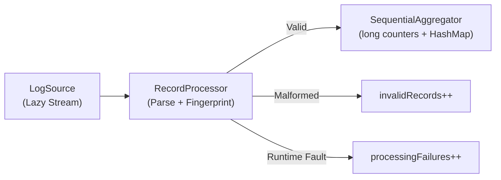
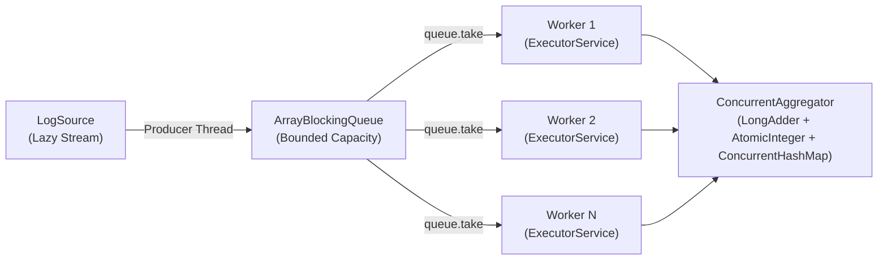

# Java Concurrency Log Pipeline

A Java 17 concurrent log ingestion, parsing, and aggregation pipeline demonstrating bounded producer-consumer backpressure, thread-safe aggregation, graceful shutdown, and empirical sequential-vs-concurrent benchmarking.

---

## 1. Project Purpose & Problem Statement

Single-threaded batch log processors couple I/O ingestion, schema parsing, enrichment/computation, and metric aggregation onto one execution thread. As per-record processing cost grows or bursty log streams arrive, a single thread under-utilizes multi-core CPUs while reading everything into heap memory risks `OutOfMemoryError`.

However, naively spawning unbounded threads or wrapping shared state in coarse `synchronized` blocks introduces race conditions, lock contention, thread leaks, or silent performance regressions when coordination overhead outweighs computation.

**Java Concurrency Log Pipeline** explores the architectural transition from sequential batch processing to bounded concurrent execution using standard `java.util.concurrent` primitives, verified by deterministic equivalence checks, JUnit 5 concurrency tests, and reproducible benchmarks over 50,000+ synthetic events.

---

## 2. Architecture: Sequential vs. Concurrent

### Sequential Mode (`SequentialPipeline`)
A single thread pulls lines lazily from a streaming `LogSource`, parses and processes each record in `RecordProcessor`, and updates unsynchronized primitive counters and a `HashMap` inside `SequentialAggregator`.



### Concurrent Mode (`BoundedLogPipeline`)
A single coordinator/producer thread streams lines into a bounded `ArrayBlockingQueue`. A fixed pool of worker threads (`ExecutorService`) consumes envelopes, executes identical `RecordProcessor` rules, and updates thread-safe counters in `ConcurrentAggregator`.



---

## 3. Transition from Single-Threaded to Multithreaded Execution

Both pipelines share the exact same `LogSource` streaming contract and `RecordProcessor` business logic. Transitioning from sequential to concurrent execution changes only two boundaries:
1. **Execution & Buffering**: `BoundedLogPipeline` introduces an `ArrayBlockingQueue` between ingestion and processing so fast ingestion cannot exhaust heap memory while workers process records in parallel.
2. **State Aggregation**: `SequentialAggregator` (plain `long` + `HashMap`) is swapped for `ConcurrentAggregator` (`LongAdder` + `AtomicInteger` + `ConcurrentHashMap`) so parallel updates never drop increments or throw `ConcurrentModificationException`.

Before comparing throughput in `--mode compare`, `BenchmarkRunner` verifies `ProcessingResult.isLogicallyEquivalent(...)` across every field (`totalRecords`, `validRecords`, `invalidRecords`, `processingFailures`, `INFO`/`WARN`/`ERROR`/`DEBUG` counts, and `errorsByService`).

---

## 4. Concurrency Design & Thread Safety

### `ExecutorService` and Fixed Thread Pool
`BoundedLogPipeline` creates a fixed-size pool (`Executors.newFixedThreadPool(workers, namedThreadFactory)`). Bounding thread count avoids unbounded thread creation and context-switch thrashing. Every submitted worker returns a `Future<?>` inspected by the coordinator so unexpected exceptions never vanish silently.

### `BlockingQueue` and Bounded Backpressure
Using an unbounded `LinkedBlockingQueue` shifts slow-consumer failures into heap growth. Instead, `BoundedLogPipeline` uses a bounded `ArrayBlockingQueue`:
- The producer first calls `queue.offer(envelope)`.
- When the queue is full (`offer` returns `false`), `blockedProducerEvents` is incremented for observability and the producer calls blocking `queue.put(envelope)`, applying natural backpressure until a worker drains a slot.

### `ConcurrentHashMap`, `LongAdder`, and `AtomicInteger`
`ConcurrentAggregator` selects lock-free/striped primitives tuned to update frequency:
- **`LongAdder`** for `totalRecords`, `validRecords`, and severity counters (`INFO`, `WARN`, `ERROR`, `DEBUG`): under multi-thread contention, `LongAdder` stripes increments across internal cells rather than forcing threads to spin on a single CAS variable.
- **`AtomicInteger`** for lower-frequency error counters (`invalidRecords`, `processingFailures`) and `maxObservedQueueDepth`, where compact single-word atomic operations suffice.
- **`ConcurrentHashMap<String, LongAdder>`** for `errorsByService`, updated via `errorsByService.computeIfAbsent(service, ignored -> new LongAdder()).increment()` without acquiring a global map lock.

### Why `java.util.concurrent` Instead of Manual `synchronized` Blocks?
Manual `synchronized` blocks are **not** inherently incorrect—for multi-field compound invariants, explicit locking (`synchronized` or `ReentrantLock`) is often the clearest tool. However, wrapping every counter and map increment in a coarse `synchronized(lock)` block serializes worker threads at the aggregation stage, turning a parallel pipeline back into a single-threaded bottleneck. Similarly, hand-rolled `wait()` / `notifyAll()` buffers invite missed signals and spurious wakeups compared to `ArrayBlockingQueue`.

---

## 5. Error Handling, Interruption & Graceful Shutdown

- **Missing / Unreadable Files**: `FileLogSource` fails fast with `NoSuchFileException` / `IOException` and returns CLI exit code `1`.
- **Malformed Log Records**: `LogParser` throws `MalformedLogException` on blank lines, wrong field counts, invalid ISO-8601 timestamps, or unrecognized severity tokens. `RecordProcessor` isolates the record, increments `invalidRecords`, and continues without corrupting valid aggregates.
- **Unexpected Runtime Exceptions**: Caught per record in `RecordProcessor` and tracked separately via `processingFailures`.
- **End-of-Stream (`POISON_PILL`)**: After `LogSource` finishes streaming, the producer enqueues one `POISON_PILL` sentinel per worker so every worker drains remaining queue items and exits cleanly.
- **Coordinator Interruption & Two-Phase Shutdown**: On `InterruptedException`, the pipeline invokes `executor.shutdownNow()`, restores `Thread.currentThread().interrupt()`, and rethrows. On normal completion, `shutdownGracefully()` runs `shutdown()`, waits up to 10 seconds via `awaitTermination()`, and falls back to `shutdownNow()` if needed.

---

## 6. Synthetic Dataset & Reproducibility

`SyntheticLogGenerator` streams deterministic log events on demand using a fixed `Random(seed)` without materializing all lines in heap memory. Each valid record follows the pipe-delimited schema:

```text
<ISO-8601-timestamp>|<LEVEL>|<service>|<eventId>|<message>
```

- **Note**: All generated events are synthetic test fixtures (60% `INFO`, 20% `DEBUG`, 13% `WARN`, 7% `ERROR`, plus configurable `--malformed-rate` defaulting to `1%`). They do not represent real company or production traffic.

---

## 7. Benchmark Methodology & Measured Results

`BenchmarkRunner` executes discarded warm-up runs (`--warmup`, default `1`) to stabilize JIT compilation, then alternates execution order across repeated trials (`--repeats`, default `3`) over identical datasets. This is an **indicative application-level benchmark** measured via `System.nanoTime()` in a single JVM, not a JMH-isolated microbenchmark.

### Measured Environment
- **Runtime**: OpenJDK `17.0.21` (64-Bit Server VM)
- **Hardware**: 2 vCPUs (`Runtime.availableProcessors() == 2`), 4096 MB RAM, Linux container
- **Dataset**: 50,000 synthetic events (`--seed 42`, `--malformed-rate 0.01`, `--queue-capacity 1000`)

### Actual Measured Output (`--mode compare --workers 4 --events 50000`)

```text
============================================================
JAVA CONCURRENCY LOG PIPELINE
============================================================
Dataset: 50,000 events (Synthetic stream (events=50000, seed=42, malformedRate=1.00%))
Warm-up Runs: 1 | Measured Repeats: 3 | Available CPU Cores: 2

Sequential Processing:
Execution Time: 1261.86 ms (avg over 3 runs)
Throughput:     49,388 records/sec

Concurrent Processing:
Workers:         4 (Queue Capacity: 1000)
Execution Time:  937.08 ms (avg over 3 runs)
Throughput:      69,508 records/sec
Max Queue Depth: 1000 | Producer Backpressure Blocks: 28

Result Verification:
Sequential and concurrent outputs: MATCH

Performance Comparison:
Concurrent mode achieved 1.35x speedup over sequential mode.
------------------------------------------------------------
Aggregation Summary:
  Total Records:       50,000
  Valid Records:       49,531
  Invalid (Malformed): 469
  Processing Failures: 0
  INFO: 29,636 | DEBUG: 9,890 | WARN: 6,511 | ERROR: 3,494
  Errors by Service:
    - api-gateway:             584
    - auth-service:            555
    - cache-node:              570
    - notification-dispatcher: 634
    - order-processor:         575
    - payment-worker:          576
============================================================
```

### Sensitivity Across Worker Counts & Workload Intensity (Measured on 2 vCPUs)

| Scenario (50,000 events) | Workers | Work Iterations | Sequential Avg (ms) | Concurrent Avg (ms) | Result Match | Measured Observation |
| :--- | :---: | :---: | :---: | :---: | :---: | :--- |
| Trivial per-record work | 4 | 0 | 1,102.50 ms | 1,192.47 ms | MATCH | Sequential **1.08x faster** (queue lock & thread handoff overhead > work) |
| Default compute | 2 | 50 | 842.90 ms | 760.82 ms | MATCH | Concurrent **1.11x faster** (1,453 backpressure blocks) |
| Default compute | 4 | 50 | 1,261.86 ms | 937.08 ms | MATCH | Concurrent **1.35x faster** |
| Oversubscribed pool | 8 | 50 | 967.33 ms | 933.83 ms | MATCH | Concurrent **1.04x faster** (8 workers contending on 2 CPU cores) |
| Heavier per-record compute | 2 | 500 | 1,671.72 ms | 1,263.84 ms | MATCH | Concurrent **1.32x faster** (11,842 backpressure blocks) |

**Key Engineering Takeaway**: Multithreading is **not** automatically faster. When `--work-iterations 0`, `ArrayBlockingQueue` locking and thread handoffs cost more than sequential parsing. When threads greatly exceed physical cores (8 workers on 2 vCPUs), context switching erodes gains. Concurrency yields consistent speedups only when per-record CPU work amortizes queue coordination overhead.

---

## 8. Technology Stack & Project Structure

- **Language**: Java 17
- **Build & Packaging**: Apache Maven 3.8+ (`maven-compiler-plugin`, `maven-surefire-plugin`, `maven-jar-plugin`)
- **Testing**: JUnit 5 (`junit-jupiter` 5.10.2)
- **Containerization**: Multi-stage Docker (`maven:3.9.6-eclipse-temurin-17` &rarr; `eclipse-temurin:17-jre-jammy`)
- **CI**: GitHub Actions (`.github/workflows/ci.yml`)

```text
java-concurrency-log-pipeline/
├── .github/
│   └── workflows/
│       └── ci.yml
├── docs/
│   ├── architecture.md
│   ├── benchmark-methodology.md
│   └── concurrency-design.md
├── src/
│   ├── main/
│   │   ├── java/com/bisher/logpipeline/
│   │   │   ├── LogProcessor.java
│   │   │   ├── aggregation/
│   │   │   │   ├── ConcurrentAggregator.java
│   │   │   │   ├── ResultAggregator.java
│   │   │   │   └── SequentialAggregator.java
│   │   │   ├── benchmark/
│   │   │   │   └── BenchmarkRunner.java
│   │   │   ├── concurrency/
│   │   │   │   ├── BoundedLogPipeline.java
│   │   │   │   └── SequentialPipeline.java
│   │   │   ├── ingestion/
│   │   │   │   ├── FileLogSource.java
│   │   │   │   ├── LogSource.java
│   │   │   │   └── SyntheticLogGenerator.java
│   │   │   ├── model/
│   │   │   │   ├── LogEvent.java
│   │   │   │   ├── LogLevel.java
│   │   │   │   ├── PipelineConfig.java
│   │   │   │   └── ProcessingResult.java
│   │   │   ├── processing/
│   │   │   │   ├── LogParser.java
│   │   │   │   ├── MalformedLogException.java
│   │   │   │   └── RecordProcessor.java
│   │   │   └── reporting/
│   │   │       └── ConsoleReporter.java
│   │   └── resources/
│   │       └── sample-logs.txt
│   └── test/java/com/bisher/logpipeline/
│       ├── LogProcessorCliTest.java
│       ├── aggregation/ConcurrencyAndAggregationTest.java
│       ├── concurrency/BoundedPipelineReliabilityTest.java
│       ├── concurrency/PipelineExecutionTest.java
│       └── processing/LogParserTest.java
├── .dockerignore
├── .gitignore
├── Dockerfile
├── pom.xml
└── README.md
```

---

## 9. Installation, Execution & Testing

### Prerequisites
- Java 17 (JDK)
- Apache Maven 3.8+

### Build, Test & Run Commands

```bash
# Run all 27 JUnit 5 tests
mvn clean test

# Compile and package executable JAR
mvn clean package

# Run sequential mode (50,000 synthetic events)
java -jar target/java-concurrency-log-pipeline.jar --mode sequential

# Run concurrent mode with 4 workers and bounded queue capacity of 1000
java -jar target/java-concurrency-log-pipeline.jar --mode concurrent --workers 4 --queue-capacity 1000

# Run sequential vs concurrent comparison benchmark
java -jar target/java-concurrency-log-pipeline.jar --mode compare --workers 4 --events 50000

# Process the bundled sample log file (contains valid + malformed entries)
java -jar target/java-concurrency-log-pipeline.jar --mode compare --workers 2 --warmup 0 --repeats 1 --input src/main/resources/sample-logs.txt
```

---

## 10. Docker Usage

```bash
# Build the multi-stage Java 17 image
docker build -t java-concurrency-log-pipeline:1.0 .

# Run default comparison mode (50,000 events, 4 workers)
docker run --rm java-concurrency-log-pipeline:1.0

# Run with custom worker count and queue capacity
docker run --rm java-concurrency-log-pipeline:1.0 --mode concurrent --workers 4 --queue-capacity 500 --events 50000
```

---

## 11. GitHub Actions CI

`.github/workflows/ci.yml` runs automatically on pushes and pull requests to `main`/`master`:
1. Configures Temurin JDK 17 with Maven dependency caching.
2. Runs `mvn -B clean test` (all JUnit 5 suites).
3. Packages `target/java-concurrency-log-pipeline.jar`.
4. Smoke-tests `sequential`, `concurrent`, and `compare` CLI executions.
5. Verifies the multi-stage `Dockerfile` build via Docker Buildx.

---

## 12. Limitations & Future Improvements

### Current Limitations
- **Single-Producer Ingestion**: Only one producer thread streams into the `ArrayBlockingQueue`, which caps maximum queue feed rate on systems with many cores.
- **Single-Queue Contention**: `ArrayBlockingQueue` uses a single `ReentrantLock` for both `put` and `take` operations.
- **Indicative Timing**: `BenchmarkRunner` measures single-JVM wall-clock timing rather than JMH-forked microbenchmarks.

### Future Engineering Improvements
- Integrate **JMH (Java Microbenchmark Harness)** for isolated fork-based latency and throughput profiling.
- Explore **work-stealing or sharded per-worker queues** (or LMAX Disruptor ring buffers) to reduce single-lock queue contention.
- Add **structured JSON report output** alongside console tables for CI regression tracking.

---

## 13. References

- [Java Platform, Standard Edition 17 API Specification](https://docs.oracle.com/en/java/javase/17/docs/api/)
- [ExecutorService (Java SE 17 API)](https://docs.oracle.com/en/java/javase/17/docs/api/java.base/java/util/concurrent/ExecutorService.html)
- [ConcurrentHashMap (Java SE 17 API)](https://docs.oracle.com/en/java/javase/17/docs/api/java.base/java/util/concurrent/ConcurrentHashMap.html)
- [AtomicInteger (Java SE 17 API)](https://docs.oracle.com/en/java/javase/17/docs/api/java.base/java/util/concurrent/atomic/AtomicInteger.html)
- [LongAdder (Java SE 17 API)](https://docs.oracle.com/en/java/javase/17/docs/api/java.base/java/util/concurrent/atomic/LongAdder.html)
- [BlockingQueue (Java SE 17 API)](https://docs.oracle.com/en/java/javase/17/docs/api/java.base/java/util/concurrent/BlockingQueue.html)
- [JUnit 5 User Guide](https://junit.org/junit5/docs/current/user-guide/)
- [Apache Maven Documentation](https://maven.apache.org/guides/)
- [Docker Documentation](https://docs.docker.com/)
- [GitHub Actions Documentation](https://docs.github.com/en/actions)
