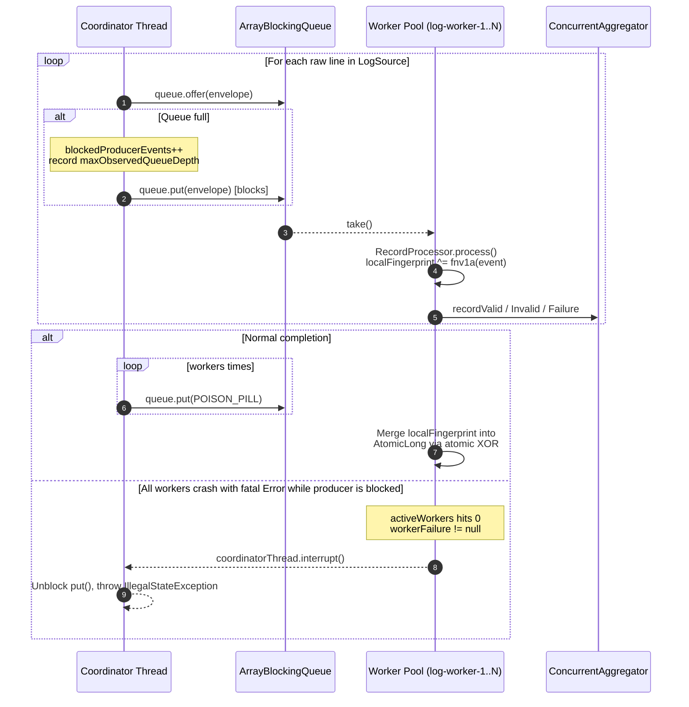

# Java Concurrency Log Pipeline

A pure JDK 17 log ingestion and aggregation pipeline comparing single-threaded execution (`SequentialPipeline`) against a bounded producer-consumer pool (`BoundedLogPipeline`).

Outside of JUnit 5 for tests, there are no external runtime dependencies. Backpressure (`ArrayBlockingQueue`), thread-local checksum accumulation, `LongAdder` counters, and worker failure isolation are built directly on the Java standard library.

## Build & Run

Requires JDK 17 and Maven 3.8+:

```bash
mvn clean test
mvn package -DskipTests
java -jar target/java-concurrency-log-pipeline.jar
```

Other examples:

```bash
# Run sequential mode on the bundled sample file
java -jar target/java-concurrency-log-pipeline.jar --mode sequential --input src/main/resources/sample-logs.txt

# Run concurrent mode with explicit queue bounds
java -jar target/java-concurrency-log-pipeline.jar --mode concurrent --workers 4 --queue-capacity 500 --events 10000

# Compare modes with lighter per-record CPU work
java -jar target/java-concurrency-log-pipeline.jar --mode compare --workers 4 --events 50000 --work-iterations 10
```

Docker build and run (`maven:3.9.6-eclipse-temurin-17` multi-stage into `eclipse-temurin:17-jre-jammy`, non-root user `pipeline`):

```bash
docker build -t java-concurrency-log-pipeline .
docker run --rm java-concurrency-log-pipeline --mode compare --workers 4 --events 50000
```

## Sample Output (`--mode compare`)

Measured with `java -jar target/java-concurrency-log-pipeline.jar --mode compare --workers 4 --events 50000` on a 4-core JDK 17 Linux runner:

```text
============================================================
JAVA CONCURRENCY LOG PIPELINE
============================================================
Dataset: 50,000 events (Synthetic stream (events=50000, seed=42, malformedRate=1.00%))
Warm-up Runs: 1 | Measured Repeats: 3 | Available CPU Cores: 4
Sequential Processing:
Execution Time: 165.20 ms (avg over 3 runs)
Throughput:     312,111 records/sec
Concurrent Processing:
Workers:         4 (Queue Capacity: 1000)
Execution Time:  101.38 ms (avg over 3 runs)
Throughput:      574,398 records/sec
Max Queue Depth: 1000 | Producer Backpressure Blocks: 32
Result Verification:
Sequential and concurrent outputs: MATCH
Performance Comparison:
Concurrent mode achieved 1.63x speedup over sequential mode.
------------------------------------------------------------
Aggregation Summary:
  Total Records:       50,000
  Valid Records:       49,531
  Invalid (Malformed): 469
  Processing Failures: 0
  INFO: 29,636 | DEBUG: 9,890 | WARN: 6,511 | ERROR: 3,494
  Errors by Service:
    - api-gateway:             584
    - auth-service:            555
    - cache-node:              570
    - notification-dispatcher: 634
    - order-processor:         575
    - payment-worker:          576
============================================================
```

## How the Pipeline Works

A single coordinator thread reads lines lazily from `LogSource` (`FileLogSource` or `SyntheticLogGenerator`) into a fixed-capacity `ArrayBlockingQueue`. Workers pull records from the queue, parse and hash them, and record results into `ConcurrentAggregator`.



Implementation notes from `concurrency/`, `processing/`, and `aggregation/`:

- **Bounded backpressure:** The coordinator tries `queue.offer()` first and falls back to blocking `queue.put()` when the queue is full, incrementing `blockedProducerEvents` and recording `maxObservedQueueDepth` so memory stays bounded if workers fall behind.
- **Aborting cleanly if all workers die:** Under normal shutdown, the coordinator pushes one `POISON_PILL` sentinel per worker. If all workers abort on an uncaught `Error` while the coordinator is parked in `queue.put()`, the last worker exiting (`activeWorkers == 0` with `workerFailure != null`) calls `coordinatorThread.interrupt()` so the coordinator unblocks instead of hanging indefinitely.
- **Avoiding shared-state contention:** Each worker updates a thread-local `localFingerprint` variable and folds it into `fingerprintSink` once at exit via atomic XOR, while event counters and `ConcurrentHashMap<String, LongAdder>` per-service error buckets use `LongAdder` striping. `RecordProcessor` catches `MalformedLogException` separately from unexpected `RuntimeException`s so bad lines do not stop healthy ones.

## Input Format & Benchmarking Rules

`LogParser` splits pipe-delimited lines with `rawLine.split("\\|", 5)`, preserving literal `|` characters inside the message field:

```text
+--------------------------+-------+-------------+----------+----------------------+
| ISO-8601 UTC timestamp   | level | serviceName | eventId  | message              |
| 2026-01-15T08:00:01.102Z | ERROR | auth-svc    | evt-0042 | free text (may keep |)
+--------------------------+-------+-------------+----------+----------------------+
```

Valid levels are `INFO`, `DEBUG`, `WARN`, and `ERROR`. A sample fixture is included at `src/main/resources/sample-logs.txt`. Because simple parsing finishes in nanoseconds, `--work-iterations` (default `50`) adjusts the FNV-1a work loop inside `RecordProcessor` to test coordination-bound vs. CPU-bound workloads.

`BenchmarkRunner` runs `--warmup` discarded passes (default `1`) before `--repeats` measured pairs (default `3`), alternating which mode runs first on each repeat (`sequential` first on even repeats, `concurrent` first on odd repeats) to avoid GC or thermal skew. Every repeat verifies `ProcessingResult.isLogicallyEquivalent()`; any mismatch exits with code `2`.

## CLI Reference

| Flag | Default | Notes |
|---|---|---|
| `--mode` | `compare` | `sequential`, `concurrent`, or `compare` |
| `--workers` | `4` | Worker threads (`>= 1`) |
| `--queue-capacity` | `1000` | Bounded `ArrayBlockingQueue` capacity (`>= 1`) |
| `--events` | `50000` | Synthetic events when `--input` is omitted (`>= 0`) |
| `--seed` | `42` | Fixed PRNG seed for `SyntheticLogGenerator` |
| `--malformed-rate` | `0.01` | Fraction of malformed records injected (`0.0..1.0`) |
| `--repeats` | `3` | Measured comparison iterations (`>= 1`) |
| `--warmup` | `1` | Discarded warm-up runs in `compare` mode (`>= 0`) |
| `--work-iterations` | `50` | Deterministic FNV-1a loops per event (`>= 0`) |
| `--input` | unset | Path to log file (disables synthetic generation) |
| `--help`, `-h` | none | Print usage and exit `0` |

Exit codes: `0` success, `1` bad arguments / I/O or execution error, `2` sequential vs. concurrent divergence in `compare` mode.

## Tests, Layout & Scope Notes

```text
src/main/java/com/bisher/logpipeline/
  LogProcessor.java       # CLI entrypoint, mode dispatch, exit codes
  ingestion/              # LogSource, lazy FileLogSource, SyntheticLogGenerator
  processing/             # LogParser, MalformedLogException, RecordProcessor
  concurrency/            # SequentialPipeline, BoundedLogPipeline
  aggregation/            # ResultAggregator, SequentialAggregator, ConcurrentAggregator
  benchmark/              # BenchmarkRunner (warm-up and alternating runs)
  reporting/              # ConsoleReporter formatting
  model/                  # LogEvent, LogLevel, PipelineConfig, ProcessingResult
src/test/java/com/bisher/logpipeline/
  LogProcessorCliTest.java
  processing/LogParserTest.java
  aggregation/ConcurrencyAndAggregationTest.java
  concurrency/PipelineExecutionTest.java
  concurrency/BoundedPipelineReliabilityTest.java
```

The five JUnit 5 suites test parsing edge cases, lost-update resistance, 50,000-event checksum and count parity, full-queue backpressure, worker crash isolation, deadlock-free abort, and CLI validation. `.github/workflows/ci.yml` runs `mvn -B clean test`, packages the JAR, executes all three CLI modes, and verifies the multi-stage Docker build.

Timings are measured in-process after warm-up rather than forked JMH runs (so GC and OS scheduling are included), processing state stays in memory without file-offset checkpointing, worker thread counts stay static during a run, and `ConcurrentAggregator` retains one `LongAdder` per distinct service with an `ERROR` event.
