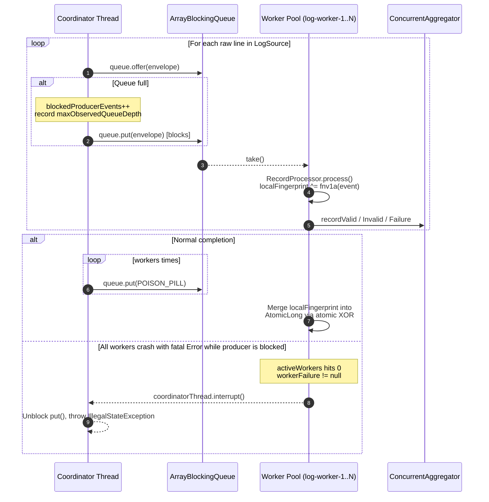

# Java Concurrency Log Pipeline

A Java 17 log ingestion, validation, and aggregation pipeline comparing single-threaded execution (`SequentialPipeline`) against a bounded producer-consumer pool (`BoundedLogPipeline`).

Outside of JUnit 5 in test scope, the codebase carries zero third-party runtime dependencies. Queue backpressure, thread-local parity fingerprinting, contended counter aggregation, and failure isolation are implemented directly on the JDK 17 standard library (`ArrayBlockingQueue`, `ExecutorService`, `LongAdder`, `ConcurrentHashMap`, `AtomicReference`).

---

## Execution Model & Backpressure

A single coordinator thread reads records lazily from `LogSource` (`FileLogSource` or `SyntheticLogGenerator`) and feeds a fixed-capacity `ArrayBlockingQueue`. Workers pull records concurrently, parse and hash each line, and aggregate counts into `ConcurrentAggregator`.



Three design details carry the concurrency guarantees:

1. **Backpressure without unbounded memory growth.** The coordinator attempts non-blocking `queue.offer()` before falling back to blocking `queue.put()`, incrementing `blockedProducerEvents` on every full-queue stall and tracking `maxObservedQueueDepth`. If downstream workers slow down, the producer blocks at the queue boundary rather than buffering millions of lines on the heap.
2. **Deadlock-free abort when workers crash.** Normal shutdown sends one `POISON_PILL` sentinel per worker after the input stream ends. The subtle failure mode is when all worker threads abort on an uncaught JVM `Error` while the coordinator is parked inside `queue.put()` on a full queue—without an explicit wake-up, the coordinator would wait forever. Each worker tracks exit via `activeWorkers`; when the final worker leaves abnormally (`remaining == 0 && !receivedPoison && workerFailure.get() != null`), it calls `coordinatorThread.interrupt()` so the caller fails fast with the underlying cause.
3. **Zero per-record contention on checksums and counters.** Updating a shared atomic checksum on every event would bounce cache lines across cores. Instead, each worker accumulates its FNV-1a-style event fingerprint in a thread-local `localFingerprint` variable and folds it into `fingerprintSink` once on exit via commutative XOR (`left ^ right`). Aggregation counters (`totalRecords`, `validRecords`, per-level counts) and per-service error buckets (`ConcurrentHashMap<String, LongAdder>`) rely on `LongAdder` striping, while `RecordProcessor` isolates schema errors (`MalformedLogException`) from unexpected `RuntimeException`s so bad records never abort healthy ones.

---

## Record Format & Tuning Compute Cost

Input lines follow a 5-field pipe-delimited layout:

```text
+--------------------------+-------+-------------+----------+----------------------+
| ISO-8601 UTC timestamp   | level | serviceName | eventId  | message              |
| 2026-01-15T08:00:01.102Z | ERROR | auth-svc    | evt-0042 | free text (may keep |)
+--------------------------+-------+-------------+----------+----------------------+
```

`LogParser` splits with `rawLine.split("\\|", 5)`, so literal `|` characters inside the message payload are preserved intact. Valid severity levels are `INFO`, `DEBUG`, `WARN`, and `ERROR`. A mixed valid/malformed fixture is included at `src/main/resources/sample-logs.txt`.

Because pure string splitting completes in nanoseconds per line, queue handoffs easily outweigh parsing overhead on small payloads. `--work-iterations` (default `50`) controls the deterministic FNV-1a pass count inside `RecordProcessor`, letting you sweep workloads from coordination-bound (where `SequentialPipeline` can beat multi-threading) to compute-bound.

---

## Benchmarking Methodology (`compare` Mode)

`BenchmarkRunner` runs `--warmup` unmeasured iterations (default `1`) to let JIT compilation settle, then executes `--repeats` measured pairs (default `3`). To avoid systematic GC or thermal bias favoring whichever pipeline runs second, `BenchmarkRunner` flips execution order on alternating repeats (`sequential` first on even indices, `concurrent` first on odd indices).

Each repeat asserts `ProcessingResult.isLogicallyEquivalent()` across total/valid/invalid/failure counts, per-level totals, and sorted `errorsByService` maps (`TreeMap`). If outputs ever diverge, `LogProcessor` exits with status `2`. When coordination overhead outweighs parallel compute gain, `ConsoleReporter` explicitly reports the slowdown rather than hiding it.

---

## Build & Run

Requires JDK 17 and Maven 3.8+:

```bash
mvn clean test
mvn package -DskipTests
```

Run standalone modes or side-by-side comparison:

```bash
# Default comparison (4 workers, queue capacity 1000, 50,000 synthetic events)
java -jar target/java-concurrency-log-pipeline.jar

# Sequential pass against the bundled sample fixture
java -jar target/java-concurrency-log-pipeline.jar --mode sequential --input src/main/resources/sample-logs.txt

# Concurrent run with explicit backpressure bounds
java -jar target/java-concurrency-log-pipeline.jar --mode concurrent --workers 4 --queue-capacity 500 --events 10000

# Compare modes with lighter per-record CPU work
java -jar target/java-concurrency-log-pipeline.jar --mode compare --workers 4 --events 50000 --work-iterations 10
```

Run via Docker (multi-stage build from `maven:3.9.6-eclipse-temurin-17` into `eclipse-temurin:17-jre-jammy`, running as non-root user `pipeline`):

```bash
docker build -t java-concurrency-log-pipeline .
docker run --rm java-concurrency-log-pipeline --mode compare --workers 4 --events 50000
```

### CLI Options & Exit Codes

| Flag | Default | Notes |
|---|---|---|
| `--mode` | `compare` | `sequential`, `concurrent`, or `compare` |
| `--workers` | `4` | Worker threads (`>= 1`) |
| `--queue-capacity` | `1000` | Bounded `ArrayBlockingQueue` capacity (`>= 1`) |
| `--events` | `50000` | Synthetic events when `--input` is omitted (`>= 0`) |
| `--seed` | `42` | Fixed PRNG seed for `SyntheticLogGenerator` |
| `--malformed-rate` | `0.01` | Fraction of malformed records injected (`0.0..1.0`) |
| `--repeats` | `3` | Measured comparison iterations (`>= 1`) |
| `--warmup` | `1` | Discarded warm-up runs in `compare` mode (`>= 0`) |
| `--work-iterations` | `50` | Deterministic FNV-1a loops per event (`>= 0`) |
| `--input` | unset | Path to log file (disables synthetic generation) |
| `--help`, `-h` | — | Print usage and exit `0` |

**Exit codes:** `0` success, `1` bad arguments / I/O error / execution failure, `2` sequential-vs-concurrent output divergence in `compare` mode.

---

## Project Layout

```text
src/main/java/com/bisher/logpipeline/
  LogProcessor.java       # CLI entrypoint, mode dispatch, and exit codes
  ingestion/              # LogSource, lazy FileLogSource, SyntheticLogGenerator
  processing/             # LogParser, MalformedLogException, RecordProcessor
  concurrency/            # SequentialPipeline and BoundedLogPipeline
  aggregation/            # ResultAggregator, SequentialAggregator, ConcurrentAggregator
  benchmark/              # BenchmarkRunner (warm-up and alternating-order runs)
  reporting/              # ConsoleReporter formatting single and comparison output
  model/                  # Immutable LogEvent, LogLevel, PipelineConfig, ProcessingResult
src/test/java/com/bisher/logpipeline/
  LogProcessorCliTest.java
  processing/LogParserTest.java
  aggregation/ConcurrencyAndAggregationTest.java
  concurrency/PipelineExecutionTest.java
  concurrency/BoundedPipelineReliabilityTest.java
```

---

## Verification & CI

The five JUnit 5 suites verify parsing edge cases (including embedded `|` preservation), lost-update resistance under contention, 50,000-event checksum and aggregation parity across varied worker/queue sizes, backpressure saturation, worker exception isolation, deadlock-free abort when all workers crash, and CLI error handling.

`.github/workflows/ci.yml` runs `mvn -B clean test`, packages the executable JAR, executes `sequential`, `concurrent`, and `compare` CLI checks, and validates the multi-stage Docker build on every push and pull request.

---

## Limitations

- **In-process wall-clock timing rather than JMH:** Measurements run inside a single JVM after warm-up rather than forked JMH processes, so numbers include host scheduling and GC pauses.
- **No durable offset checkpointing:** `BoundedLogPipeline` processes streams in memory; a JVM crash mid-file does not resume from the last processed line.
- **Unbounded service map keys:** `ConcurrentAggregator` retains one `LongAdder` per distinct `serviceName` with an `ERROR` event, assuming bounded service cardinality.
- **Static worker count:** The worker `ExecutorService` runs a fixed thread count for the duration of a pipeline execution without dynamic scaling.
